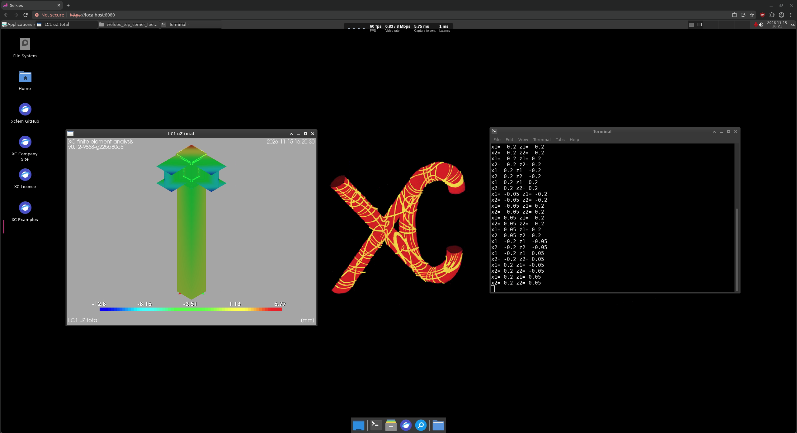

## xc-desktop demo

This is an experimental desktop image adapted from XC’s existing Docker build. It adds an XFCE desktop accessible through a browser using Selkies.



## Install and use

1. Install Podman or Docker with Compose support.
2. Save [compose.yaml](compose.yaml) in a folder. Inside that folder, create an empty `workspace` subfolder and run the command below:

   ```bash
   podman compose up -d
   ```

   For Docker, use `docker compose up -d`.

3. Open https://localhost:8080 in your **browser** (see below). Log in as `xc` with password `1234`.

**Browser**: 
A Chromium-based browser (such as Chrome, Brave, Vivaldi, or Helium) is recommended. Firefox had higher latency and lower frame rates during testing.

## Optional SSH

SSH can be useful for working with XC from an IDE.

1. In the folder containing `compose.yaml`, add your SSH public key to the desktop workspace. The public key goes in `workspace/.ssh/authorized_keys`

2. Uncomment `XC_ENABLE_SSH` and the port mapping in `compose.yaml`, then run `podman compose up -d` to apply the change. (Or `docker compose up -d`)

3. Connect from the machine running the container. You can check the connection with `ssh -p 2332 xc@127.0.0.1`.

4. Optionally, connect to the container from your IDE using SSH.

To turn SSH off, comment out both lines and run `podman compose up -d` again.

## Manual Build

Use the [Containerfile](Containerfile) to build the image on your own system. See [example](examples/build_locally.md)

## other notes
root commands:

```bash
podman compose exec --user root xc "command"
```

## Third-party notices

See [Third-party notices](THIRD_PARTY_NOTICES.md) for credits and license information for XC, Selkies, the desktop packages, and others.
